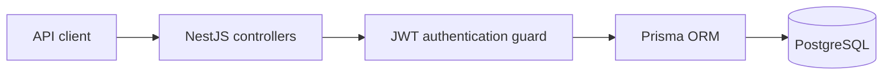

# Architecture

Each request to project/task endpoints is authenticated. Project ownership is checked before task access. Passwords are hashed with bcrypt. This is a portfolio starter, not a production-hardened system.

## Production improvements
- Add integration/e2e tests with an isolated test database
- Add refresh token rotation, rate limiting, request IDs, structured logging
- Replace development JWT fallback with mandatory secret validation
- Add pagination, audit logs, deployment and monitoring
- Add explicit role-based guards if admin workflows are introduced
